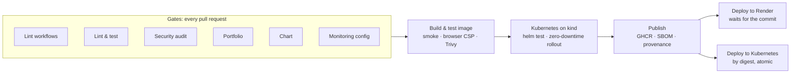

# CI/CD Pipeline Automation

[](https://github.com/underratedgitter/CI-CD-Pipeline-Automation-with-Docker-Cloud-Deployment/actions/workflows/pipeline.yml)
[](https://github.com/underratedgitter/CI-CD-Pipeline-Automation-with-Docker-Cloud-Deployment/actions/workflows/codeql.yml)
[](https://scorecard.dev/viewer/?uri=github.com/underratedgitter/CI-CD-Pipeline-Automation-with-Docker-Cloud-Deployment)
[](LICENSE)

A small Node service — which also serves my portfolio site at `/` — used as a vehicle for the parts around it: a GitHub Actions pipeline that gates, tests, signs and deploys; a hardened container image; Prometheus instrumentation with SLO burn-rate alerting; and a Helm chart that is installed on a real Kubernetes cluster and rolled under traffic on every pull request.

**Live:** [ci-cd-pipeline-automation-app.onrender.com](https://ci-cd-pipeline-automation-app.onrender.com)

What each change goes through before it is live:

- **Tested where it runs.** The image is started and probed from outside, the portfolio is rendered in headless Chrome under the real Content-Security-Policy, and the chart is installed on a three-node kind cluster where every pod is replaced while a client calls the Service; one dropped request fails the build.
- **Signed and attested.** The image that passed is the image that ships, with signed SLSA build provenance and an SBOM attached in the registry, verifiable by anyone.
- **Secured end to end.** CodeQL, Trivy, Dependabot, OpenSSF Scorecard, npm signature verification, SHA-pinned actions and linted workflows.
- **Observed by objectives.** Availability and latency SLOs with multi-window, multi-burn-rate alerts, and unit tests for every alert rule.

---

## The pipeline

`.github/workflows/pipeline.yml`.



| Job | Does | Runs on |
|---|---|---|
| **Lint Workflows** | `actionlint` (with shellcheck on every `run:` block) and `zizmor` for workflow security | every change |
| **Lint & Test** | ESLint, then Jest with coverage thresholds | every change |
| **Security Audit** | `npm audit` (runtime blocks, dev reports) and `npm audit signatures` | every change |
| **Lint & Build Portfolio** | `oxlint`, `npm audit signatures`, then `tsc -b && vite build` | every change |
| **Lint & Validate Chart** | `helm lint` on both value sets, `kubeconform` against the real Kubernetes schemas, Trivy config scan | every change |
| **Validate Monitoring Config** | `promtool` checks the config and both rule sets, and unit-tests the alert rules | every change |
| **Build & Test Image** | Buildx build; `tests/smoke.sh` probes the container; `tests/browser/csp-check.sh` renders the portfolio in Chrome; Trivy blocks fixable HIGH and CRITICAL | every change |
| **Kubernetes Integration Test** | Installs the chart with that image on a 3-node kind cluster, runs `helm test`, then rolls every pod under continuous traffic | every change |
| **Publish Image** | Pushes the tested image to GHCR (and Docker Hub if configured), attests SLSA provenance and an SPDX SBOM, uploads the scan to the Security tab | push to `main` |
| **Deploy to Kubernetes** | `helm upgrade --install --atomic` at the published digest, then `helm test` | push, if a cluster is configured |
| **Deploy to Render** | Deploy hook, then waits until `/info` reports the pushed commit | push, if the hook is configured |

Pull requests and manual runs go as far as the Kubernetes test — nothing
unreviewed reaches a registry or a deployment. On a pull request a newer push
cancels the running check; on `main` runs queue, so two deploys never overlap.

Nothing has to be configured for the pipeline to pass. GHCR authenticates with
the token the workflow already holds, so there is no registry secret at all; the
deploy jobs check for their credentials in a `guard` job and skip themselves
when a fork or a fresh clone does not have them.

| Configured with | Enables |
|---|---|
| *(nothing)* | every check, the kind test, push to GHCR with provenance and SBOM |
| `KUBE_CONFIG` (base64 kubeconfig) | the Kubernetes deploy |
| `RENDER_DEPLOY_HOOK_URL` | the Render deploy |
| `DOCKER_USERNAME` / `DOCKER_PASSWORD` | an additional Docker Hub push |

A few details that are deliberate rather than incidental:

- **The image that ships is the image that was tested.** The build job saves the
  image once the smoke test, browser check and scan pass; the Kubernetes test and
  publish load that saved image rather than rebuilding, and Kubernetes deploys it
  by digest. A tag is a pointer that can move between the test and the deploy;
  the digest cannot.
- **A deploy is done when the new code is serving, not when the old code answers.**
  The Render job polls `/info` until it reports the pushed commit (or a newer one
  that contains it). Polling `/health` passed while Render was still building,
  because the previous version kept answering.
- **`--atomic` on the upgrade.** If the new pods never pass readiness, Helm rolls
  back and the previous version keeps serving, rather than leaving the release
  half-applied.

### Supply chain

- **Provenance and SBOM on every image.** `actions/attest` signs both with
  keyless Sigstore and pushes them to the registry next to the image. Anyone can
  check an image came from this repository's workflow, and which commit:

  ```bash
  gh attestation verify oci://ghcr.io/underratedgitter/ci-cd-pipeline-app:latest \
    --owner underratedgitter
  ```

- **Pinned, and kept current.** Actions are pinned to commit SHAs and container
  tools to image digests; a release tag is a pointer its owner, or whoever
  compromises them, can move. Dependabot keeps the pins, both lockfiles and the
  base images current, with a seven-day cooldown so a hijacked release is usually
  pulled before it is ever proposed.
- **Installs that cannot run code.** `npm ci --ignore-scripts` everywhere, in CI
  and in the Dockerfile, and `npm audit signatures` verifies every package
  against the registry's signatures.
- **Scanned from three sides.** CodeQL (`security-extended`) on the JavaScript and
  on the workflows, Trivy on the image and the rendered manifests, OpenSSF
  Scorecard on the repository's practices.
- **Least privilege.** Every job declares its own token permissions, checkouts
  don't leave the token on disk, secrets reach scripts through `env` rather than
  being pasted into the script source, and every job has a time limit.

See [SECURITY.md](SECURITY.md) for reporting a vulnerability.

### Keeping the free tier awake

Render sleeps a free web service after 15 minutes without inbound traffic, and
the next visitor waits through a cold start of ten seconds or more. A free
[cron-job.org](https://cron-job.org) job requests
`https://ci-cd-pipeline-automation-app.onrender.com/health` every five minutes,
which keeps the app awake. It is configured on cron-job.org, not in this repo.

It is external on purpose. Render cron jobs have no free plan, and a GitHub
Actions schedule is best effort: a `*/5` schedule fired every 2 to 10 hours
(median 4.5) over 24 days, never inside the 15-minute window. Only the app is
kept awake, because the free plan's 750 instance-hours a month cover one
always-on service, not three.

`.github/workflows/uptime-check.yml` is a backup: an hourly check that `/health`
answers, where a failed run is the alert.

---

## The image

Three stages, so build tooling never reaches the final layer:

```dockerfile
FROM node:26-alpine AS deps       # npm ci --omit=dev --ignore-scripts
FROM node:26-alpine AS portfolio  # npm ci --ignore-scripts && vite build
FROM node:26-alpine               # node_modules, app.js, portfolio/dist
```

- **A numeric non-root user, `10001:10001`.** Kubernetes can only enforce
  `runAsNonRoot` against a numeric user; with a name like `appuser` the kubelet
  cannot verify it and refuses the pod. The chart used to fail exactly that way
  on every cluster, which the kind test now catches.
- **No package managers at runtime.** npm, npx, corepack and yarn are removed
  from the final image; nothing calls them, and they carried the image's only
  fixable HIGH findings.
- **Code the process cannot rewrite.** Application files are owned by root and
  only readable by the app user.
- **Knows what it is.** `NODE_ENV=production` by default, and the commit it was
  built from is baked in and reported at `/info`.

Manifests are copied before source so a code change doesn't invalidate the
dependency layer, and a `HEALTHCHECK` polls `/health` every 30 seconds, so an
unhealthy container is visible to Docker and to anything orchestrating it.
`tests/smoke.sh` checks all of this against the built image.

---

## Instrumentation

Five metrics, exported at `/metrics` in Prometheus format via `prom-client`:

| Metric | Type | Answers |
|---|---|---|
| `http_requests_total` | Counter | throughput, by route and status |
| `http_request_duration_seconds` | Histogram | latency distribution, so p99 is real rather than an average |
| `http_requests_in_progress` | Gauge | concurrency right now |
| `http_errors_total` | Counter | error rate |
| `nodejs_app_info` | Gauge | version, revision and environment, for correlating a spike with a deploy |

Node's default process metrics — heap, RSS, event-loop lag, GC — come along with them.

### SLOs and alerting

`prometheus/alert_rules.yml` alerts on service level objectives rather than
fixed thresholds:

| Objective | Target | Error budget |
|---|---|---|
| Availability | 99.5% of requests do not return 5xx | 0.5% |
| Latency | 99% of requests complete within 0.5s | 1% |

Following the [Google SRE Workbook](https://sre.google/workbook/alerting-on-slos/),
each objective has multi-window, multi-burn-rate alerts. Each pairs a long
window (is this significant?) with a short one (is it still happening?), so an
alert fires fast and also clears fast once the problem stops:

| Burn rate | Windows | Budget spent | Severity |
|---|---|---|---|
| 14.4× | 1h and 5m | 2% | critical: page |
| 6× | 6h and 30m | 5% | critical: page |
| 3× | 1d and 2h | 10% | warning: ticket |

The SLIs are recording rules, aggregated per job before dividing. Beside the SLO
alerts: `AppDown`, `HighClientErrorRate` (4xx stay out of the availability SLO
but a surge means a broken client or a scanner), heap, RSS and event-loop lag,
and `LowRequestRate`, because no error-rate alert can see requests that never
arrive.

**The rules are unit-tested.** `prometheus/tests/alert_rules_test.yml` feeds
`promtool` synthetic series and checks every alert both fires and stays quiet.
It exists because the previous rules divided each 5xx series by itself, which
reads 100% after a single error: a critical page at a 0.1% error rate. That case
is now a regression test.

---

## Endpoints

| Route | Returns |
|---|---|
| `GET /` | the portfolio site (static files from `portfolio/dist`) |
| `GET /api/status` | service name, version, revision, environment |
| `GET /health` | liveness, with uptime and memory |
| `GET /ready` | readiness, for orchestrator gating |
| `GET /metrics` | Prometheus exposition format |
| `GET /info` | build and runtime detail, including the commit being served |

`/health`, `/ready` and `/metrics` are deliberately exempt from rate limiting — a limiter that throttles your own health checks turns a traffic spike into an outage.

Rate limiting is a fixed window, 100 requests per minute per IP by default, tunable with `RATE_LIMIT_MAX`.

Portfolio files are served ahead of the limiter too: one page view is a dozen requests, so counting them would lock a visitor out after a few reloads. They share one `static` route label in the metrics. Vite's content-hashed `assets/` are cached as immutable; everything else is sent with `no-cache` so a deploy shows up on the next load.

### Response headers

- **A strict Content-Security-Policy** with no `'unsafe-inline'` and no
  allow-listed hosts: the portfolio loads nothing from elsewhere and has no
  inline script or style. CI renders the page in Chrome under the real policy
  and fails on any violation report.
- `Cross-Origin-Opener-Policy`, `Cross-Origin-Resource-Policy`,
  `Permissions-Policy`, `X-Content-Type-Options`, `Referrer-Policy`,
  `X-Frame-Options`, and HSTS in production.
- `X-XSS-Protection: 0`, as OWASP recommends: the auditor it controlled is gone
  from current browsers and could be abused where it existed.
- `X-Request-Id` is propagated when a caller sends a short, plain one and
  generated otherwise, since it ends up in headers and logs.

---

## Running it

```bash
npm ci --ignore-scripts
npm run dev          # node --watch
npm test             # jest, with coverage
npm run lint
docker build -t pipeline-app:local . && bash tests/smoke.sh pipeline-app:local
```

`npm run dev` serves the portfolio only if it has been built. Build it with
`cd portfolio && npm ci --ignore-scripts && npm run build`, or run `npm run dev`
inside `portfolio/` for Vite's hot-reloading dev server.

The whole stack — app, Prometheus and Grafana on a shared network:

```bash
npm run docker:up    # builds, starts, opens all three
npm run docker:down
```

| Service | URL |
|---|---|
| App | http://localhost:3000 |
| Prometheus | http://localhost:9090 |
| Grafana | http://localhost:3001 |

Grafana provisions its datasource and the `nodejs-overview` dashboard automatically — no manual setup after first boot.

[CONTRIBUTING.md](CONTRIBUTING.md) lists which check to run for which change.

### Generating load

Dashboards are meaningless against zero traffic:

```bash
npm run traffic
```

Drives requests at the service so the histograms fill, the gauges move, and the alert thresholds can actually be exercised.

---

## Kubernetes

`deploy/helm/pipeline-app` is the chart. It renders twelve objects: Deployment,
Service, Ingress, HPA, PodDisruptionBudget, ServiceAccount, ConfigMap, Secret,
NetworkPolicy, ServiceMonitor, PrometheusRule, and a `helm test` pod that checks
`/health`, `/ready` and `/metrics` and fails the release if any of them is wrong.

```bash
make -C deploy up      # kind cluster, ingress, build, load, install, test, zero-downtime rollout
make -C deploy status
make -C deploy down
```

The kind cluster is three nodes rather than one, so the topology spread
constraint and the disruption budget are actually exercised. On a single node
both are satisfied trivially and prove nothing. CI builds the same cluster on
every pull request.

### Zero downtime, tested

`deploy/kind/zero-downtime-test.sh` runs a client inside the cluster that calls
the Service ten times a second, through kube-proxy as real traffic would, while
`kubectl rollout restart` replaces every pod. A single failed request fails the
test. Hundreds of requests pass with none dropped; switching the Deployment to
`Recreate` makes it fail, as it should. (`kubectl port-forward` would be no use
here: it pins one pod and breaks when that pod terminates.)

### The parts worth explaining

**`/ready` returns 503 while draining.** It used to return 200 unconditionally,
which made the graceful shutdown decorative — the process closed its listener
politely while the Service kept routing new requests to it. The SIGTERM handler
now flips a flag that readiness reads, so the endpoint is withdrawn first.
`/health` deliberately keeps returning 200 during the drain: a liveness failure
would have the kubelet SIGKILL the pod part-way through, which is the opposite of
what a graceful shutdown is for.

**A `preStop` sleep of five seconds.** The kubelet sends SIGTERM without waiting
for kube-proxy to finish removing the endpoint on every node. Those two race, and
without the pause a slice of requests is routed to a pod that has already started
shutting down.

**A startup probe, so the liveness probe can be strict.** Node with a cold module
cache takes a few seconds. Without a startup probe, the liveness probe has to be
slack enough to tolerate that on every check for the life of the pod — which is
how liveness probes end up never detecting anything.

**Hard memory limit, no CPU limit.** Memory is not compressible; over the limit
something gets killed, so the limit is the safety net. CPU is compressible, and a
limit throttles the container at its quota even when the node is idle — latency
the dashboards cannot explain.

**Read-only root filesystem**, `runAsNonRoot` as user `10001`, all capabilities
dropped, `RuntimeDefault` seccomp, and the service account token not mounted,
because the app never calls the Kubernetes API. The image already runs as that
numeric user; the chart enforces it at admission rather than trusting the image.

**The alert rules move too, and change.** `deploy/helm/pipeline-app/templates/prometheusrule.yaml`
carries the Compose-era rules plus what Kubernetes adds — crash-looping, HPA
pinned at max replicas — and two of them are rewritten for the new environment:

- `AppDown` became `absent(up{...} == 1)`. `up == 0` cannot fire on a total
  outage, because when the last pod goes away the series stops existing rather
  than reporting zero. That is exactly the case the alert is for.
- `HighMemoryRSS > 200MB` became working set over the container's memory *limit*.
  A fixed byte threshold means nothing once the scheduler owns the limit; what
  matters is proximity to the number the OOM killer uses.

### Deploying to a real cluster

Base64 a kubeconfig into `KUBE_CONFIG`, set `K8S_NAMESPACE` and `APP_URL` as
repository variables, and the pipeline takes it from there. Infrastructure to run
it on — VPC, cluster, load balancer, registry, IAM — is Terraform in
[terraform-aws-ecs-platform](https://github.com/underratedgitter/terraform-aws-ecs-platform).

---

## Layout

```
app.js                        service, metrics, rate limiting, headers, serves the portfolio
portfolio/                    the portfolio site (React + Vite), built into the image
traffic-gen.js                load generator for the dashboards
Dockerfile                    multi-stage, numeric non-root user, no package managers
docker-compose.yml            app + prometheus + grafana
prometheus/
  prometheus.yml              scrape config
  alert_rules.yml             SLO recordings, burn-rate alerts, symptom alerts
  tests/                      promtool unit tests for every alert
grafana/
  provisioning/               datasource + dashboard auto-config
  dashboards/                 nodejs-overview
deploy/
  helm/pipeline-app/          the chart: 12 objects, two value sets
  kind/cluster.yaml           3-node cluster, used locally and in CI
  kind/zero-downtime-test.sh  rollout under continuous traffic
  Makefile                    up / test / zero-downtime / lint / template / down
tests/                        jest + supertest suites
  smoke.sh                    probes the built image from outside
  browser/                    renders the portfolio in Chrome under the real CSP
.github/
  workflows/pipeline.yml      gates, tests, publish, deploy
  workflows/codeql.yml        static analysis of the code and the workflows
  workflows/scorecard.yml     OpenSSF Scorecard
  workflows/uptime-check.yml  hourly backup check of the live app
  dependabot.yml              actions, npm and Docker updates, with a cooldown
render.yaml                   deploy target
```

---

[Contributing](CONTRIBUTING.md) · [Security](SECURITY.md) · [MIT License](LICENSE)
